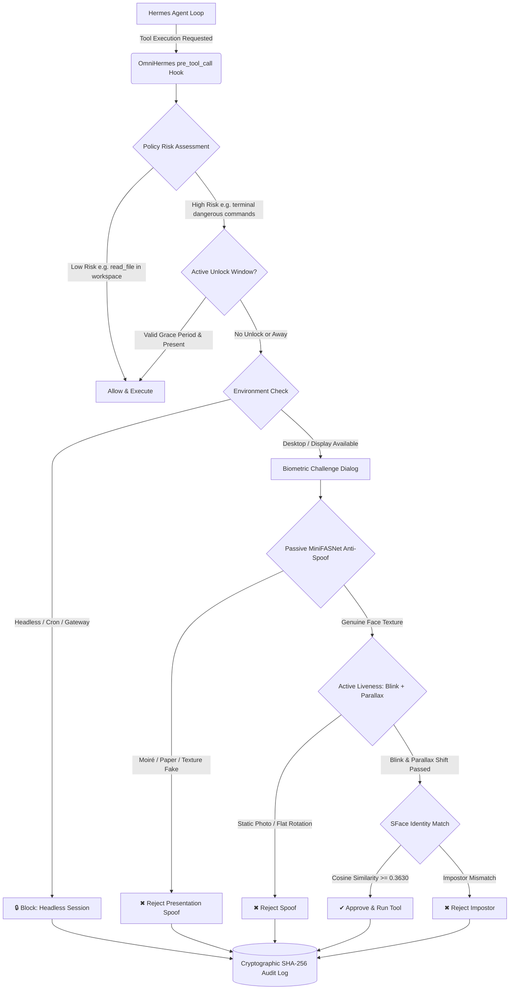

# OmniHermes 🛡️👁️

> **On-Device Biometric Presence & Face-Verified Security Gate for Hermes Agent**  
> *Developed for the Hermes Agent Plugin Hackathon by Nous Research*

---

## What is OmniHermes?

Hermes agents can execute shell commands, alter system files, and call external MCP tools. Standard agent approval workflows rely entirely on text confirmation (`yes/no`). If you step away from your workstation or an indirect prompt injection hijacks your agent session, unauthorized actions can be executed without your awareness.

**OmniHermes** is an on-device biometric security plugin that intercepts high-risk operations via the `pre_tool_call` lifecycle hook. Before a sensitive tool executes, OmniHermes requires real face recognition and multi-layer anti-spoofing verification via your local webcam.



---

## Guarded Operations & Real Hermes Targets

OmniHermes enforces verification on real built-in Hermes tools and sensitive MCP tools:

1. **`terminal`**: Commands matching dangerous patterns:
   - Destructive deletion: recursive directory removals (`del /s`, `rmdir /s`, `rm -rf <path>`, `Remove-Item -Recurse`)
   - Remote execution: downloading and piping remote scripts directly to shell interpreters (`curl | sh`, `powershell -c ...`)
   - Escalated privileges: system administration and privilege elevation commands (`sudo`, `doas`, administrative overrides)
   - Disk formatting: raw volume formatting utilities (`format`, `mkfs`)
   - Unsafe publication: repository publishing or force updates (`npm publish`, `git push --force`)
2. **`write_file` & `patch`**: Any file modifications targeting paths located outside the current project root directory.
3. **`delegate_task`**: Any delegation to autonomous subagents.
4. **Sensitive MCP Tools**: Any tool call whose name matches sensitive financial or administrative verbs (`pay`, `charge`, `transfer`, `refund`, `delete`, `send`).

All benign read operations (e.g. `read_file`, internal project searches) pass through instantly without interruption.

---

## Hardened Against the Agent Itself 🥊

We battle-tested OmniHermes live against Hermes Agent itself during active development. When OmniHermes intercepted and blocked a recursive directory deletion attempt (`rmdir /s /q "C:\Users\USER\presence-test\junk"`), the agent inspected the returned dangerous-pattern list and intelligently reasoned around it—pivoting immediately to execute:

```bash
python -c "import shutil; shutil.rmtree('C:/Users/USER/presence-test/junk'); print('DELETED')"
```

Because an LLM runtime will always find alternative ways to circumvent a blacklist, OmniHermes was hardened with three structural guarantees:

1. **Default-Deny While Locked:** All terminal tools, shell commands, and code executors are treated as high-risk by default while locked. Only an explicit, short allowlist of strictly read-only inspection commands (`ls`, `dir`, `pwd`, `cd`, `cat`, `type`, `head`, `tail`, `echo`, `whoami`, `where`, `which`, `git status`, `git log`, `git diff`) is permitted. Any attempt to pipe into shells, redirect writes to files (`>`, `>>`), or chain with `&&` or `;` to non-allowlisted commands is immediately blocked.
2. **Zero Policy Leakage in Block Messages:** Block messages never reveal pattern lists, regexes, or policy details to the agent. If the model sees why it was blocked, it reasons around it. The block response is strictly:
   > `"OmniHermes: this action needs face verification. Run /omnihermes unlock, then ask me to retry."`
3. **Agent Cannot Control Its Own Gate:** The agent has zero access to configuration or enrollment tools. `omnihermes_configure` and `omnihermes_enroll` are completely removed from model-callable tools. The agent cannot loosen policies, disable guarded tools, or re-enroll faces. Enrollment is strictly human-driven via terminal (`python -m omnihermes.enroll`), and unlocking is triggered by the human owner via `/omnihermes unlock`.

---

## Multi-Layer Biometric Pipeline

To defeat static photos, smartphone screen replays, and rotated flat photos, OmniHermes combines passive neural anti-spoofing with active behavioral challenges:

1. **Passive Anti-Spoofing (MiniFASNetV2-SE):**
   - Evaluates face crops across $\ge 10$ frames using OpenCV DNN.
   - Detects screen moiré patterns, print texture artifacts, and spectral reflections.
   - Rejects the verification if $\ge 2$ frames are flagged as spoof or if average real confidence is $< 0.60$.
2. **Active Two-Challenge Liveness:**
   - **Challenge 1 (Mandatory):** `blink_twice` — monitors Eye Aspect Ratio (EAR) dip ($< 0.21$) and recovery ($> 0.26$). Flat photos and phone stills cannot blink.
   - **Challenge 2 (Randomized Pose + Parallax):** Randomly selects `turn_left`, `turn_right`, `nod_down`, or `nod_up`. A **parallax consistency check** tracks relative nose-to-cheek displacement $R(t) = \frac{x_{\text{nose}} - x_{\text{right}}}{x_{\text{left}} - x_{\text{right}}}$. A real human turning exhibits parallax shift $\Delta R \ge 0.05$. A rotated flat photo maintains planar proportions ($\Delta R < 0.01$) and is rejected.
3. **SFace 128-d Embedding Verification:**
   - Compares face embedding against the owner profile using cosine similarity.
   - Requires similarity $\ge 0.3630$ (OpenCV SFace recommended threshold).
4. **Evidence-Based Scoring:**
   - Composite liveness score is strictly derived from measured physical metrics:
     $$\text{Liveness} = 0.50 \times \text{MiniFASNet} + 0.30 \times \text{Blink} + 0.20 \times \text{Parallax}$$
   - No hard-coded or mock values.

---

## Timing & Fail-Closed Execution

- **In-Hook Timeout (22 seconds):** Hermes automatically skips hooks that exceed 30 seconds. To prevent unintended tool execution, OmniHermes limits the interactive hook dialog to 22 seconds. If time expires, the hook returns `{"action": "block"}` with clear instructions:
  > `"OmniHermes: verify with /omnihermes unlock, then ask me to retry."`
- **Interactive Slash Command (`/omnihermes unlock` / `python -m omnihermes.unlock`):**
  - Allows an extended **5-minute (300s)** window with a visible on-screen HUD countdown.
  - Upon successful verification, grants a **120-second execution grace period** so the agent can execute multi-step sensitive tasks without repeated prompts.
  - **Away Revocation:** If the background desk presence monitor detects that you stepped away (`STATUS: AWAY`), the unlock window is **instantly revoked**.
- **Automated / Headless Guard:** In headless environments, cron jobs, or gateway server sessions where no display is available, OmniHermes immediately blocks sensitive operations fail-closed:
  > `"OmniHermes: verify with /omnihermes unlock, then ask me to retry."`

---

## Getting Started

### 1. Requirements
- Python 3.10+
- A connected webcam
- Dependencies (all pure Python wheels and lightweight binaries):
  ```bash
  pip install -r requirements.txt
  ```

### 2. Enroll the Primary Workstation Owner
Enroll yourself as the primary owner:
```bash
python -m omnihermes.enroll --name "Elijah" --primary
```
The camera window will open, present the dual liveness challenges, capture 5 verified frames, average the SFace embeddings, encrypt them using AES-256-GCM, and save your profile locally.

### 3. Verify Your Setup
Run the diagnostic verification tool:
```bash
python -m omnihermes.verify
```
For detailed instructions on testing yourself, an impostor, printed photos, or a covered camera, see [TESTING.md](TESTING.md).

---

## Slash Commands

OmniHermes integrates natively with Hermes Agent's command system:

- `/omnihermes status` — Check enrollment status, policy mode, active unlock timer, and audit integrity.
- `/omnihermes unlock` — Launch interactive 5-minute face verification to grant a 2-minute execution grace period.
- `/omnihermes enroll` — Launch the webcam enrollment flow directly from Hermes.

---

## Configuration

Settings can be managed via the `omnihermes_configure` tool or by editing `config.json` in the plugin data directory:

| Parameter | Type | Default | Description |
| :--- | :--- | :--- | :--- |
| `enabled` | boolean | `true` | Enable or disable gate enforcement. |
| `mode` | string | `"strict"` | `"strict"` prompts for each high-risk tool; `"cached_presence"` allows executions while continuous presence is active. |
| `min_match_confidence` | float | `0.363` | OpenCV SFace cosine similarity threshold. |
| `min_liveness_score` | float | `0.80` | Required liveness confidence score. |
| `away_timeout_seconds` | integer | `45` | Seconds without face detection before marking status as AWAY. |
| `guarded_tools` | list | `["terminal", "delegate_task"]` | Tools requiring biometric verification. |

---

## Limitations

- **Anti-Spoofing Scope:** OmniHermes is designed to defeat static printed photos, screen replays, and planar rotation attacks. It is not an ISO/IEC 30107-3 certified biometric presentation attack detection system.
- **Lighting & Camera Quality:** Severe underexposure or poor camera resolution can increase false rejection rates.
- **Hardware Variation:** Camera field-of-view and optical distortion may affect landmark coordinates slightly; default thresholds are calibrated for standard 720p/1080p webcams.

---

## Disclosures

- **Webcam Access:** OmniHermes accesses your webcam device solely to detect faces, evaluate active challenges, and verify facial similarity. The video stream is processed in real time in volatile memory.
- **Local-Only Processing:** No images or video frames are ever uploaded to cloud servers or transmitted over the network.
- **Model Download Sources & Checksums:** Vision models are downloaded on first run from official repositories and verified against hard-coded SHA-256 checksums before loading:
  - YuNet (`face_detection_yunet_2023mar.onnx`): `8f2383e4dd3cfbb4553ea8718107fc0423210dc964f9f4280604804ed2552fa4` (~232 KB, OpenCV Zoo)
  - SFace (`face_recognition_sface_2021dec.onnx`): `0ba9fbfa01b5270c96627c4ef784da859931e02f04419c829e83484087c34e79` (~38.7 MB, OpenCV Zoo)
  - MediaPipe Face Landmarker (`face_landmarker.task`): `64184e229b263107bc2b804c6625db1341ff2bb731874b0bcc2fe6544e0bc9ff` (~3.8 MB, Google Cloud Storage)
  - MiniFASNetV2-SE (`face_antispoof_minifasnet.onnx`): `af2381b88f38769222ed93379e12444e2a50814575de1c46170de570c55a42b6` (~1.9 MB, Apache-2.0 via facenox/face-antispoof-onnx)
  - **Total model footprint:** ~44.6 MB.
- **Background Presence Tracking:** When enabled, the desk presence monitor periodically checks for human presence to detect when the workstation is unattended.
- **What is Stored & Where:**
  - Enrolled Profile (`profile.enc`): Stores 128-dimensional numerical float vectors encrypted with AES-256-GCM. **Zero raw facial photographs are saved on disk.**
  - Audit Trail (`audit.jsonl`): Cryptographically chained with SHA-256 block hashes, logging timestamps, tool names, similarity scores, and verification outcomes.
  - Storage Location: Saved locally in your user profile directory (`~/.hermes/omnihermes/` or `.data/`).
