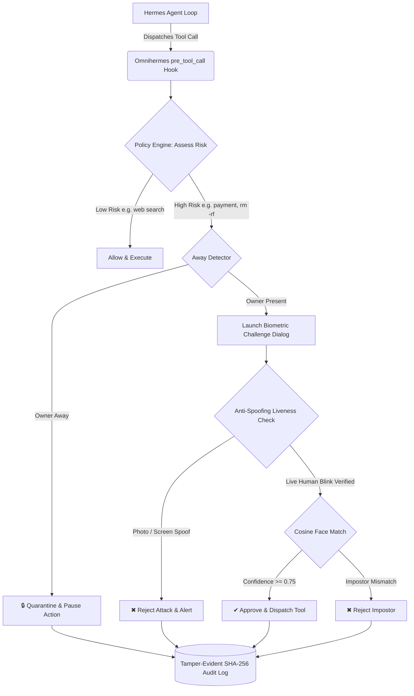

# Omnihermes 🛡️👁️

> **On-Device Biometric Presence & Face-Verified Security Gate for Hermes Agent**  
> *Developed for the Hermes Agent Plugin Hackathon by Nous Research*

---

## 💡 The Problem

Hermes agents can run shell commands, interact with production APIs, manage local files, and initiate financial transactions. However, traditional agent approval mechanisms rely on a simple text confirmation (`yes/no` prompt). This introduces severe security vulnerabilities:
1. **Unattended Execution:** Anyone who sits at the keyboard can approve catastrophic actions while the owner is away.
2. **Prompt Injection & Confusion:** Malicious instructions or prompt injection can mislead users into approving dangerous actions.
3. **No Real Human Identity:** Standard agents cannot verify *who* is giving permission.

**A prompt or a skill cannot fix this.** Enforcing human physical identity requires deep hardware access, video perception, anti-spoofing liveness verification, and intercepting the agent's core runtime loop.

---

## 🚀 The Solution: Omnihermes

**Omnihermes** is a native Hermes Agent plugin that intercepts high-risk operations via the `pre_tool_call` lifecycle hook and enforces real-time biometric authorization before the agent is allowed to execute them.



---

## ✨ Key Features

- **🔍 Hardware-Bound Biometric Interception:** Intercepts sensitive tools (payments, shell commands, messaging, database operations) before they hit the execution registry.
- **👁️ Anti-Spoofing Liveness Detection:** Dual-phase validation defeats static photo printouts, screen video replays, and deepfakes via dynamic eye-blink verification (Eye Aspect Ratio dip) and micro-motion texture entropy analysis.
- **🔐 Zero-Knowledge Biometric Privacy:** **Zero raw face images are stored on disk.** Facial embeddings are encrypted with AES-256-GCM using hardware-derived keys via PBKDF2-HMAC-SHA256.
- **☕ Desk Away-Detection:** Continuously tracks presence. If the owner walks away from the desk for more than the configurable timeout (default 45s), high-risk operations are automatically quarantined.
- **📜 Tamper-Evident Audit Chain:** Every single authorization, rejection, spoof attempt, and config change is chained using SHA-256 block hashes, ensuring cryptographically verifiable auditability.
- **🖥️ Hermes Desktop Integration:** Native status bar widget and command palette actions to monitor security posture in real-time.

---

## 📦 Project Structure

```text
omnihermes/
├── plugin.yaml                  # Hermes plugin manifest
├── plugin-catalog/
│   └── omnihermes.yaml          # Official Hermes marketplace catalog entry
├── __init__.py                  # Plugin entrypoint & pre_tool_call hook
├── schemas.py                   # Tool definitions exposed to LLM
├── tools.py                     # Tool implementations
├── core/
│   ├── biometrics.py            # Face embedding, cosine similarity & liveness engine
│   ├── crypto.py                # AES-256-GCM encryption for embeddings
│   ├── policy.py                # Rule engine & risk assessment
│   ├── away.py                  # Inactivity & away state tracker
│   ├── audit.py                 # SHA-256 hash-chained audit logger
│   └── ui.py                    # Tkinter camera authorization modal
├── desktop/
│   └── plugin.js                # Hermes Desktop status bar & menu integration
├── tests/                       # Complete automated unit test suite (15 tests)
└── demo/
    └── run_demo.py              # Interactive 90-second demo script
```

---

## 🛠️ Installation & Setup

### 1. Requirements
- Python 3.10+
- Webcam (or headless mock mode)
- Dependencies:
```bash
pip install -r requirements.txt
```

### 2. Validate Plugin
Test your local plugin using the Hermes CLI:
```bash
hermes plugins validate . --install-deps
```

### 3. Enroll Owner Biometrics
Enroll the authorized workstation owner:
```bash
# Via Hermes CLI or Agent prompt:
"Enroll owner Alice with Omnihermes"
```

---

## 🧪 Running Unit Tests

Omnihermes includes 15 automated unit tests covering encryption, tamper detection, spoof rejection, and hook interception:

```bash
python -m unittest discover tests -v
```

---

## 🎥 90-Second Demo Script

To reproduce the hackathon demo flow:
```bash
python demo/run_demo.py
```

### Demo Steps (<90 seconds):
1. **0:00 - 0:15:** Owner Alice enrolled; embeddings encrypted on-device.
2. **0:15 - 0:30:** Agent asked to execute payment of $49; biometric gate triggers camera challenge; blink + face match authorizes payment.
3. **0:30 - 0:45:** Impostor attempts crypto transfer -> Rejected (Confidence: 31%).
4. **0:45 - 0:60:** Attacker holds up printed glossy photo -> Anti-spoofing flags zero micro-motion -> Spoof rejected.
5. **0:60 - 0:75:** Alice walks away -> Away detector quarantines dangerous shell actions automatically.
6. **0:75 - 0:90:** Cryptographic audit verification verifies 100% chain integrity.

---

## 📄 License
Apache-2.0. Built by FaceTrust AI for the Hermes Agent Community.
