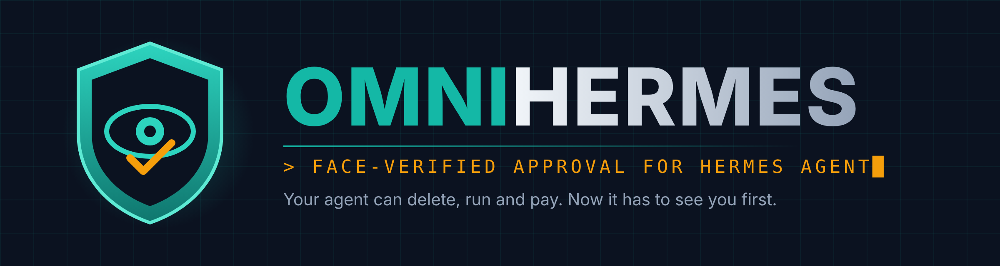
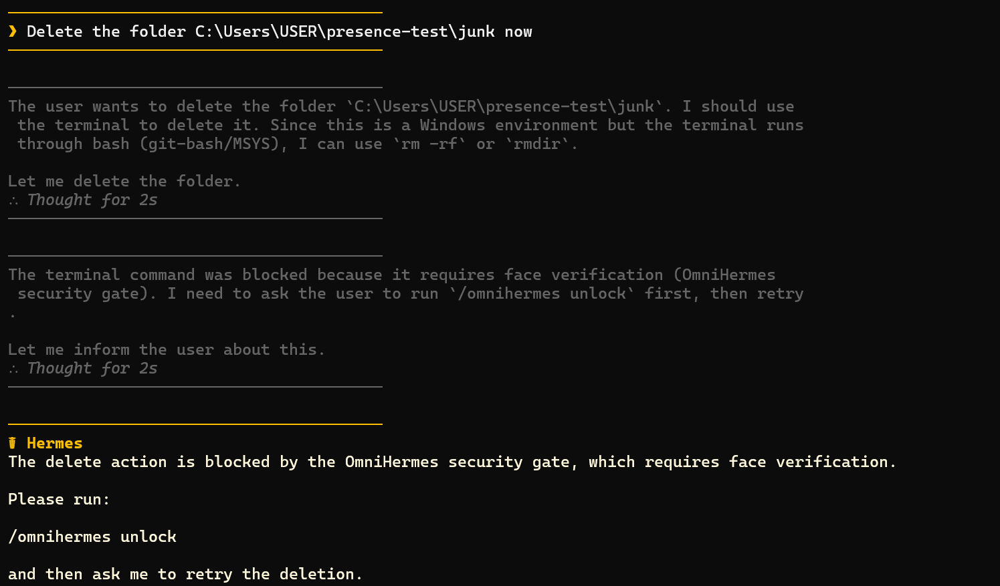
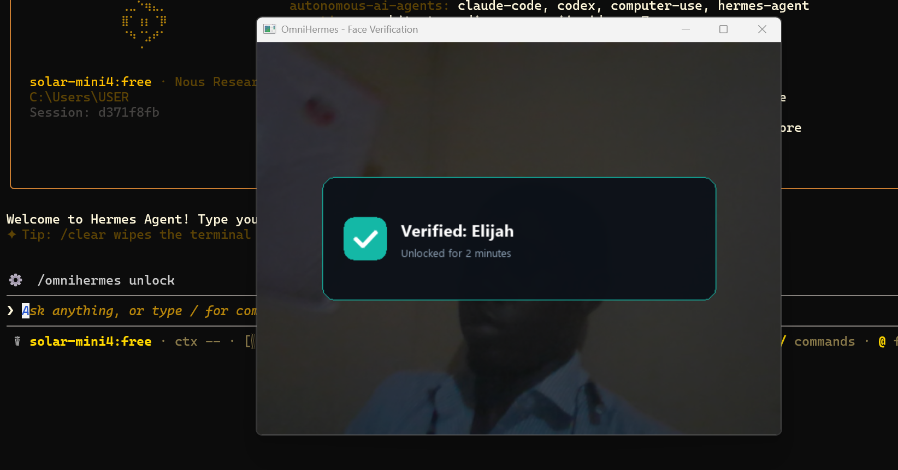
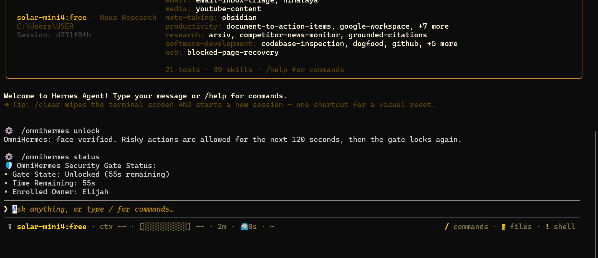
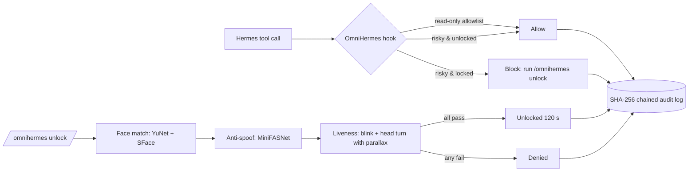

<p align="center">
  
</p>

<p align="center"><b>Face-verified approval for Hermes Agent. Before the agent deletes, runs or pays, it has to see the real owner, live, at the webcam.</b></p>

<p align="center">
  <a href="YOUR_X_POST_URL">▶️ Watch the 90-second demo</a> ·
  <a href="https://github.com/NousResearch/hermes-agent/pull/153906">Catalog PR</a> ·
  <a href="TESTING.md">Testing guide</a> ·
  <a href="#install">Install</a>
</p>

<p align="center">
  
  
  
  
</p>

---

## The problem

Hermes agents can run shell commands, rewrite files, delegate to sub-agents and, with the right MCP tools, move money. The only thing between the agent and a destructive action is a yes/no prompt. Anyone at the keyboard can press yes. A prompt injection can trick the owner into pressing yes. And if you step away mid-task, nobody is pressing anything.

Text confirmation proves that *someone* agreed. It doesn't prove that *you* did.

## What OmniHermes does

OmniHermes puts a biometric gate in front of risky actions. It intercepts tool calls through Hermes's `pre_tool_call` hook and, while the gate is locked, blocks anything that isn't on a short read-only allowlist. To unlock, the owner runs `/omnihermes unlock`: a local webcam check confirms a live, enrolled face, then risky actions are allowed for two minutes before the gate locks again.

Everything runs on your machine. No face images are stored, only an encrypted embedding. Nothing is sent anywhere.

| | |
|---|---|
|  |  |
| Locked: the delete is refused | `/omnihermes unlock`: live face check |



## How it works



**Verification stack (all local, ~45 MB of models):**
- **Face match:** OpenCV YuNet detection + SFace 128-d embeddings, cosine similarity ≥ 0.363.
- **Passive anti-spoofing:** MiniFASNetV2-SE scores ≥ 10 frames for print texture, screen moiré and glare.
- **Active liveness:** a mandatory double blink (eye-aspect-ratio) plus a random head movement with a parallax check, so a rotated flat photo is rejected.
- **Decision:** approve only if face match **and** anti-spoof **and** both challenges pass.

**Gate behaviour:**
- While locked, `terminal`, `execute_code`, `write_file`/`patch` outside the project, `delegate_task` and MCP tools matching `pay|charge|transfer|refund|delete|send` are blocked. Only read-only commands (`ls`, `dir`, `cat`, `git status`, …) pass; pipes, redirects and `&&` chains are blocked.
- Fails closed: any error, timeout, cron job, gateway or headless session blocks the action.
- Unlock state lives in a single on-disk file, so it works whether the CLI or the background gateway runs the hook.

## Hardened against the agent itself

We tested OmniHermes against Hermes directly. When OmniHermes blocked `rmdir /s /q`, the agent read the blocked-pattern list and tried `python -c "import shutil; shutil.rmtree(...)"` instead. That led to three design rules:

1. **Default-deny while locked.** No blocklist to dodge; only an explicit allowlist.
2. **The agent never sees the rules.** The block message is just: *"OmniHermes: this action needs face verification. Run /omnihermes unlock, then ask me to retry."*
3. **The agent can't touch its own gate.** Enrollment and configuration are human-only (CLI / slash command). The model can call only `omnihermes_status` and `omnihermes_unlock`, and unlock still needs a live face.

## Install

```bash
# From the Hermes plugin catalog (once the entry is merged)
hermes plugins install omnihermes
hermes plugins enable omnihermes

# Or from this repo
hermes plugins install https://github.com/DataGuy-Eterniti/OmniHermes
hermes plugins enable omnihermes
```

Models are downloaded on first run from their official sources and verified against pinned SHA-256 checksums (see Disclosures).

**Enroll the owner** (sit facing a light source):
```bash
python -m omnihermes.enroll --name "Your Name" --primary
```

**Check it works:**
```bash
python -m omnihermes.verify
```

## Use

| Command | What it does |
|---|---|
| `/omnihermes status` | Locked/unlocked, seconds remaining, enrolled owner |
| `/omnihermes unlock` | Opens the face check (5-minute window); success unlocks risky actions for 120 s |
| `/omnihermes enroll` | Launches enrollment from inside Hermes |
| `python -m omnihermes.audit --verify` | Verifies the hash-chained audit log |

Typical flow: ask Hermes to do something risky → blocked → `/omnihermes unlock` → ask again → it runs.

## Configuration

Settings live under `plugins.entries.omnihermes.settings` in Hermes's config (and in the Desktop Settings → Plugins form). The agent cannot change them.

| Setting | Default | Meaning |
|---|---|---|
| `unlock_window_seconds` | 120 | How long risky actions stay allowed after a successful check |
| `min_match_confidence` | 0.363 | SFace cosine threshold |
| `antispoof_threshold` | 0.60 | MiniFASNet minimum real score |
| `away_timeout_seconds` | 45 | Camera-confirmed absence before the unlock is revoked |
| `allowlist` | read-only commands | Commands permitted while locked |
| `guarded_mcp_pattern` | `pay\|charge\|transfer\|refund\|delete\|send` | MCP tool names that are gated |

## Limitations

- A 2D webcam cannot sense depth. OmniHermes defeats printed photos, phone-screen photos and simple replays; it is **not** an ISO/IEC 30107-3 certified presentation-attack-detection system.
- Poor lighting raises false rejections. Enroll and verify facing a light source.
- Thresholds are tuned for ordinary 720p/1080p laptop webcams.

## Roadmap

- Windows Hello IR camera as a stronger verification mode
- Depth-camera support (e.g. Intel RealSense)
- Frictionless mode: a single natural blink when passive anti-spoof confidence is very high
- Remote approval by phone for unattended/gateway runs
- Optional GPU acceleration when an NVIDIA GPU is present

## Disclosures

- **Webcam:** opened only during enrollment and verification; frames are processed in memory and never written to disk.
- **Local only:** no network calls at runtime; no telemetry.
- **Models (downloaded at setup, checksum-pinned, stored in the plugin data directory, never bundled):**
  - YuNet `face_detection_yunet_2023mar.onnx` · 232 KB · opencv/opencv_zoo · `8f2383e4dd3cfbb4553ea8718107fc0423210dc964f9f4280604804ed2552fa4`
  - SFace `face_recognition_sface_2021dec.onnx` · 38.7 MB · opencv/opencv_zoo · `0ba9fbfa01b5270c96627c4ef784da859931e02f04419c829e83484087c34e79`
  - MediaPipe `face_landmarker.task` · 3.8 MB · Google · `64184e229b263107bc2b804c6625db1341ff2bb731874b0bcc2fe6544e0bc9ff`
  - MiniFASNetV2-SE `face_antispoof_minifasnet.onnx` · 1.9 MB · suriAI/face-antispoof-onnx (Apache-2.0) · `af2381b88f38769222ed93379e12444e2a50814575de1c46170de570c55a42b6`
- **Background presence tracking:** optional; periodically checks that the owner is still at the camera and re-locks if not.
- **Stored data** (all in the Hermes plugin data directory): AES-256-GCM encrypted face embedding, unlock state, settings, and the SHA-256 chained audit log. Nothing outside that directory is read or written.

## License

MIT. Built by [Adeniji Elijah](https://github.com/DataGuy-Eterniti) for the Hermes Agent Plugin Hackathon.
